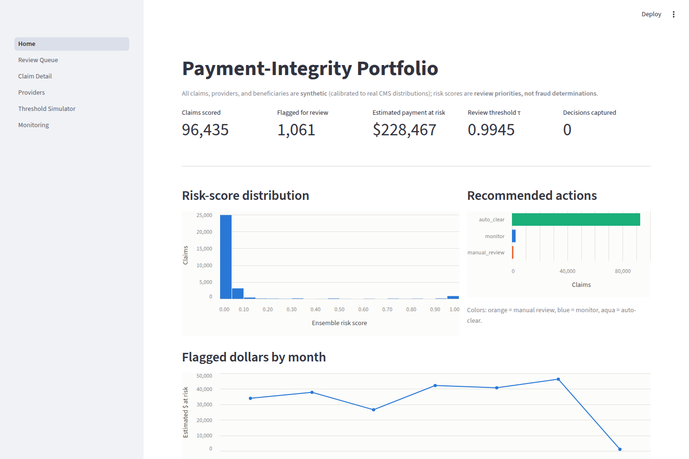
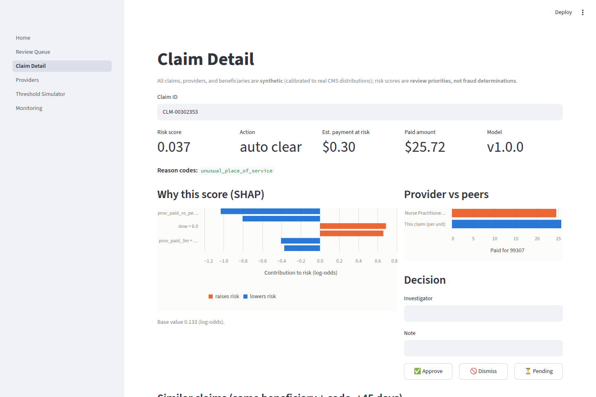
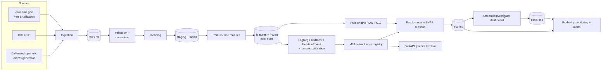

# Healthcare claims payment-integrity and FWA detection platform

[](https://github.com/FaridoonFarahi/healthcare-payment-integrity/actions/workflows/ci.yml)


[Live dashboard demo](https://faridoon-payment-integrity.streamlit.app), hosted on Streamlit
Community Cloud from the committed sample bundle. The full stack (scoring API, MLflow, Postgres)
runs through the local or Azure setups below.

This platform scores healthcare claims for fraud, waste, and abuse (FWA) risk and sends
investigators to the claims most worth reviewing. A rule engine, supervised ML, and unsupervised
anomaly detection feed one calibrated risk score. Around that score sit SHAP reason codes, a
cost-based review policy, a FastAPI scoring service, a Streamlit investigator dashboard, MLflow
tracking, Evidently drift monitoring, CI/CD, and Azure deployment.

| | |
|---|---|
| Investigator dashboard |  |
| Claim-level explanation |  |

> Responsible use: every output is a *review priority*, never a fraud determination.
> Supervision labels are **synthetic** (documented injections, see
> [docs/labeling.md](docs/labeling.md)). No real provider is ever scored or displayed as risky.

## The business problem

CMS's CERT program estimated **[$28.8B of improper Medicare fee-for-service payments in
FY2025](https://www.fiercehealthcare.com/regulatory/cms-estimates-medicare-made-288b-improper-payments-fy2025)**
([CERT program](https://www.cms.gov/data-research/monitoring-programs/improper-payment-measurement-programs/comprehensive-error-rate-testing-cert)),
and the [NHCAA](https://www.nhcaa.org/tools-insights/about-health-care-fraud/the-challenge-of-health-care-fraud/)
conservatively puts health-care fraud at ~3% of spending (some estimates up to 10%). Payers handle
this with payment-integrity teams: a fixed number of investigators working a queue of suspect
claims. The platform answers five operational questions:

1. Which claims should an investigator review? A calibrated ensemble risk score ranks a
   capacity-constrained queue.
2. Why was each claim flagged? Deterministic rule hits and SHAP feature contributions, mapped to
   plain-language reason codes.
3. What is the estimated financial risk? `P(improper) × paid amount`, calibrated
   (Brier 0.012, ECE 0.001).
4. How should claims be prioritized under limited capacity? An expected-net-value framework,
   `recoverable − review cost − false-positive cost`, optimized over thresholds and capacities,
   with a live simulator.
5. Is the model drifting? Evidently drift reports, PSI and mix-divergence alerts, and delayed
   precision from investigator decisions.

## Results (test window: 6 months, 96,435 synthetic claims, 4.7% injected-improper)

| Model | PR-AUC | ROC-AUC | Recall@1% | Recall@5% | Recall@10% |
|---|---|---|---|---|---|
| Rules baseline | 0.273 | 0.722 | 0.123 | 0.409 | 0.500 |
| Logistic regression | 0.571 | 0.910 | 0.170 | 0.607 | 0.755 |
| **XGBoost** | **0.881** | 0.963 | 0.212 | **0.836** | 0.907 |
| Isolation Forest | 0.316 | 0.837 | 0.125 | 0.372 | 0.550 |
| Ensemble (0.95·XGB + 0.05·anomaly) | 0.871 | 0.948 | 0.211 | 0.835 | 0.901 |

Reviewing the top 5% of claims captures 83.6% of injected improper claims. At the production
operating point (1% capacity, τ = 0.9945), precision is 0.994, realized net value is $49.3k on
the window, and about $674k is identified per 1,000 reviews. A novel-scheme holdout (retraining
without two pattern families) shows the anomaly path recovering ~5× more unseen-scheme claims than
the supervised path alone. It still misses most of them, which is why layered controls are needed.
Full analysis: [docs/evaluation_report.md](docs/evaluation_report.md).

## Architecture



Design details: [docs/architecture.md](docs/architecture.md). Data contract:
[docs/data_dictionary.md](docs/data_dictionary.md).

## The data (read this before the metrics)

Claim-level Medicare data with adjudicated fraud labels **does not exist publicly**. This project
says so and works around it:

- Real public CMS data anchors the generator. A committed snapshot of the *Medicare Physician &
  Other Practitioners* provider-service file (12 specialties, real HCPCS mix, real payment
  distributions) calibrates the generator and builds peer benchmarks. The OIG LEIE exclusion list
  ships with a loader as real-world context.
- **Synthetic claim-level data** (~378k claims, 2k providers, 24 months) is generated from those
  real distributions, with **12 documented FWA patterns injected** (duplicates, upcoding,
  unbundling, unit inflation, collusion clusters, and others). Benign confounders (corrected
  resubmissions, legit high-cost claims) are added so the model faces real false-positive pressure.
- Labels live in a separate schema and never enter features. Every injection assumption is in
  [docs/labeling.md](docs/labeling.md). Metrics measure *detection of documented injections*, and
  every report says so.

## Leakage prevention

Splits are temporal, with a burn-in window. Every rolling feature looks strictly backward
(`closed='left'`). Provider features are at monthly grain and lagged one month. Peer statistics
are fit on the train window and frozen as artifacts. Duplicates can only match *earlier* claims,
and the feature builder rejects label columns. `tests/unit/test_leakage.py` enforces all of this
(future-append invariance, frozen-stats fingerprints, label isolation).

## Quickstart

```bash
git clone https://github.com/FaridoonFarahi/healthcare-payment-integrity.git
cd healthcare-payment-integrity
python -m venv .venv && source .venv/bin/activate
make install                 # deps
make compose-up              # Postgres + MLflow (Docker)
make pipeline                # data → features → train → evaluate → score   (~10 min)
make monitor                 # Evidently drift run (add SIMULATE=--simulate-drift to demo alerts)
make api                     # FastAPI :8000  →  /docs
make dashboard               # Streamlit :8501
make test                    # unit suite · make test-all for integration + slow
```

Or fully containerized: `make pipeline && make compose-serve`
(API :8000, dashboard :8501, MLflow :5001). Azure deployment:
[docs/deployment.md](docs/deployment.md).

## Scoring API

```bash
curl -s localhost:8000/predict -H 'Content-Type: application/json' -d '{
  "claim_id": "CLM-102849", "bene_id": "BEN-004521", "provider_id": "PRV-00042",
  "specialty": "Internal Medicine", "hcpcs": "99215", "units": 1, "dx_group": "DXG02",
  "pos": "11", "service_date": "2025-11-10", "submit_date": "2025-11-18",
  "submitted_amount": 420.0, "allowed_amount": 210.0, "paid_amount": 168.0}'
```

```json
{
  "claim_id": "CLM-102849",
  "risk_score": 0.2263,
  "recommended_action": "auto_clear",
  "estimated_payment_at_risk": 32.94,
  "reason_codes": ["potential_upcoding_pattern"],
  "rule_hits": ["R010_upcoding_indicator"],
  "model_version": "claims-risk-v1.0.0",
  "scored_at": "2026-08-07T06:53:27Z"
}
```

Endpoints: `GET /health`, `GET /model-info`, `POST /predict`, `POST /batch-predict` (≤1,000),
`POST /explain` (adds SHAP contributions and labeled reasons), `GET /metrics` (Prometheus).
More examples: [docs/api_examples.md](docs/api_examples.md).

## Repository map

```
app/            FastAPI service · Streamlit dashboard · schemas · services (online features)
configs/        generation, validation, features, rules, model, costs, reasons, monitoring (YAML)
data/reference/ committed REAL CMS snapshot + code sets (provenance in metadata JSON)
docs/           architecture, data dictionary, labeling, model card, evaluation report, guides
infra/azure/    Container Apps provisioning + teardown
scripts/        pipeline CLIs (build_dataset, build_features, train, evaluate, score, monitor, gate)
src/            data · features · modeling · evaluation · monitoring · utils
tests/          unit (fast) · integration (live API) · slow (training invariants)
```

## Engineering practices

The code passes Ruff and MyPy, with ~110 tests across unit, integration, and slow suites. Before
the Docker build and health smoke test, CI runs a model-quality regression gate: a tiny-world
pipeline must beat PR-AUC and recall floors and the rules baseline. Logs are structured JSON with
request IDs, the model loads from the registry first with a local fallback, and every chart uses a
validated, CVD-safe palette.

## Monitoring

An Evidently drift preset covers 16 monitored columns. In-house checks add PSI on the risk score,
Jensen-Shannon divergence on provider and procedure mix, monthly-volume deltas, and missing-value
tracking. Together they produce an `ok / warn / critical` status that the dashboard reads, and
investigator decisions feed a delayed realized-precision report. Simulated drift (pricing shift,
mix change, missingness) escalates to **critical** (score PSI 3.81) as expected. Guide:
[docs/monitoring.md](docs/monitoring.md).

## Limitations and future work

Synthetic labels limit external validity: results measure detection of documented injections
([full discussion](docs/ethics_limitations.md)). Only single-line professional claims are covered
(no institutional or DRG structures). Peer stats and provider features refresh at batch cadence.
Planned next: real NCCI PTP full-file loading, a LEIE weak-label provider study, Alembic
migrations, authN/authZ, champion-challenger deployment, and graph features for collusion
detection.

## Documentation index

- [Architecture](docs/architecture.md)
- [Roadmap](docs/roadmap.md)
- [Data dictionary](docs/data_dictionary.md)
- [Labeling](docs/labeling.md)
- [Evaluation report](docs/evaluation_report.md)
- [Model card](docs/model_card.md)
- [API examples](docs/api_examples.md)
- [Deployment](docs/deployment.md)
- [Monitoring](docs/monitoring.md)
- [Ethics and limitations](docs/ethics_limitations.md)
- [3-minute demo script](docs/demo_script.md)

## License

MIT, see [LICENSE](LICENSE). The CMS data used here is public, and the committed sample keeps its
provenance metadata.
