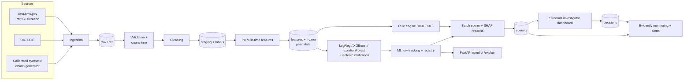

# Healthcare Claims Payment-Integrity & FWA Detection Platform

[](https://github.com/FaridoonFarahi/healthcare-payment-integrity/actions/workflows/ci.yml)


An end-to-end, production-style platform that scores healthcare claims for fraud, waste, and
abuse (FWA) risk and routes investigator attention where it pays: a rule engine, supervised ML,
and unsupervised anomaly detection behind one calibrated risk score — with SHAP reason codes, a
cost-based review policy, a FastAPI scoring service, a Streamlit investigator dashboard, MLflow
tracking, Evidently drift monitoring, CI/CD, and Azure deployment.

| | |
|---|---|
| **Investigator dashboard** |  |
| **Claim-level explanation** |  |

> **Responsible-use note:** every output is a *review priority*, never a fraud determination.
> Supervision labels are transparently **synthetic** (documented injections — see
> [docs/labeling.md](docs/labeling.md)); no real provider is ever scored or displayed as risky.

---

## The business problem

CMS's CERT program estimated **[$28.8B of improper Medicare fee-for-service payments in
FY2025](https://www.fiercehealthcare.com/regulatory/cms-estimates-medicare-made-288b-improper-payments-fy2025)**
([CERT program](https://www.cms.gov/data-research/monitoring-programs/improper-payment-measurement-programs/comprehensive-error-rate-testing-cert)),
and the [NHCAA](https://www.nhcaa.org/tools-insights/about-health-care-fraud/the-challenge-of-health-care-fraud/)
conservatively puts health-care fraud at ~3% of spending (some estimates up to 10%). Payers attack
this with **payment-integrity teams**: finite investigators reviewing a queue of suspect claims.
The operational questions this platform answers:

1. **Which claims should an investigator review?** — a calibrated ensemble risk score ranks a
   capacity-constrained queue.
2. **Why was each claim flagged?** — deterministic rule hits + SHAP feature contributions,
   mapped to plain-language reason codes.
3. **What is the estimated financial risk?** — `P(improper) × paid amount`, calibrated
   (Brier 0.012, ECE 0.001).
4. **How should claims be prioritized under limited capacity?** — an expected-net-value
   framework: `recoverable − review cost − false-positive cost`, optimized over thresholds and
   capacities, with a live simulator.
5. **Is the model drifting?** — Evidently drift reports + PSI/mix-divergence alerts + delayed
   precision from investigator decisions.

## Results (test window: 6 months, 96,435 synthetic claims, 4.7% injected-improper)

| Model | PR-AUC | ROC-AUC | Recall@1% | Recall@5% | Recall@10% |
|---|---|---|---|---|---|
| Rules baseline | 0.273 | 0.722 | 0.123 | 0.409 | 0.500 |
| Logistic regression | 0.571 | 0.910 | 0.170 | 0.607 | 0.755 |
| **XGBoost** | **0.881** | 0.963 | 0.212 | **0.836** | 0.907 |
| Isolation Forest | 0.316 | 0.837 | 0.125 | 0.372 | 0.550 |
| Ensemble (0.95·XGB + 0.05·anomaly) | 0.871 | 0.948 | 0.211 | 0.835 | 0.901 |

Reviewing the **top 5%** of claims captures **83.6%** of injected improper claims. At the
production operating point (1% capacity → τ = 0.9945): precision **0.994**, realized net value
**$49.3k** on the window, ~$674k identified per 1,000 reviews. A **novel-scheme holdout**
(retraining without two pattern families) shows the anomaly path recovering ~5× more unseen-scheme
claims than the supervised path alone — and still missing most, the honest case for layered
controls. Full analysis: [docs/evaluation_report.md](docs/evaluation_report.md).

## Architecture



Design details: [docs/architecture.md](docs/architecture.md) ·
data contract: [docs/data_dictionary.md](docs/data_dictionary.md)

## The data story (read this before the metrics)

Claim-level Medicare data with adjudicated fraud labels **does not exist publicly**. This project
handles that honestly instead of pretending otherwise:

- **Real public CMS data** anchors everything: a committed snapshot of the *Medicare Physician &
  Other Practitioners* provider-service file (12 specialties, real HCPCS mix, real payment
  distributions) calibrates the generator and builds peer benchmarks; the OIG LEIE exclusion list
  ships with a loader as real-world context.
- **Synthetic claim-level data** (~378k claims, 2k providers, 24 months) is generated from those
  real distributions, with **12 documented FWA patterns injected** (duplicates, upcoding,
  unbundling, unit inflation, collusion clusters…) plus benign confounders (corrected
  resubmissions, legit high-cost claims) so false-positive pressure is real.
- **Labels live in a separate schema** and never enter features; every injection assumption is in
  [docs/labeling.md](docs/labeling.md). Metrics measure *detection of documented injections* —
  stated on every report.

## Leakage prevention (the part reviewers probe)

Temporal splits with a burn-in window; every rolling feature strictly backward-looking
(`closed='left'`); provider features at monthly grain **lagged one month**; peer statistics fit on
the train window and **frozen as artifacts**; duplicates can only match *earlier* claims; label
columns structurally rejected by the feature builder. All of it is enforced by
`tests/unit/test_leakage.py` (future-append invariance, frozen-stats fingerprints, label
isolation).

## Quickstart

```bash
git clone https://github.com/FaridoonFarahi/healthcare-payment-integrity.git
cd healthcare-payment-integrity
python -m venv .venv && source .venv/bin/activate
make install                 # deps
make compose-up              # Postgres + MLflow (Docker)
make pipeline                # data → features → train → evaluate → score   (~10 min)
make monitor                 # Evidently drift run (add SIMULATE=--simulate-drift to demo alerts)
make api                     # FastAPI :8000  →  /docs
make dashboard               # Streamlit :8501
make test                    # unit suite · make test-all for integration + slow
```

Or fully containerized: `make pipeline && make compose-serve`
(API :8000, dashboard :8501, MLflow :5001). Azure deployment:
[docs/deployment.md](docs/deployment.md).

## Scoring API

```bash
curl -s localhost:8000/predict -H 'Content-Type: application/json' -d '{
  "claim_id": "CLM-102849", "bene_id": "BEN-004521", "provider_id": "PRV-00042",
  "specialty": "Internal Medicine", "hcpcs": "99215", "units": 1, "dx_group": "DXG02",
  "pos": "11", "service_date": "2025-11-10", "submit_date": "2025-11-18",
  "submitted_amount": 420.0, "allowed_amount": 210.0, "paid_amount": 168.0}'
```

```json
{
  "claim_id": "CLM-102849",
  "risk_score": 0.2263,
  "recommended_action": "auto_clear",
  "estimated_payment_at_risk": 32.94,
  "reason_codes": ["potential_upcoding_pattern"],
  "rule_hits": ["R010_upcoding_indicator"],
  "model_version": "claims-risk-v1.0.0",
  "scored_at": "2026-08-07T06:53:27Z"
}
```

Endpoints: `GET /health` · `GET /model-info` · `POST /predict` · `POST /batch-predict` (≤1,000)
· `POST /explain` (adds SHAP contributions + labeled reasons) · `GET /metrics` (Prometheus).
More: [docs/api_examples.md](docs/api_examples.md).

## Repository map

```
app/            FastAPI service · Streamlit dashboard · schemas · services (online features)
configs/        generation, validation, features, rules, model, costs, reasons, monitoring (YAML)
data/reference/ committed REAL CMS snapshot + code sets (provenance in metadata JSON)
docs/           architecture, data dictionary, labeling, model card, evaluation report, guides
infra/azure/    Container Apps provisioning + teardown
scripts/        pipeline CLIs (build_dataset, build_features, train, evaluate, score, monitor, gate)
src/            data · features · modeling · evaluation · monitoring · utils
tests/          unit (fast) · integration (live API) · slow (training invariants)
```

## Engineering practices

Ruff + MyPy clean · ~110 tests across unit/integration/slow suites · CI runs a **model-quality
regression gate** (tiny-world pipeline must beat PR-AUC/recall floors and the rules baseline)
before Docker build + health smoke · structured JSON logs with request IDs · registry-first model
loading with local fallback · every chart follows a validated, CVD-safe palette.

## Monitoring

Evidently drift preset over 16 monitored columns + in-house PSI (risk score), Jensen-Shannon
divergence (provider/procedure mix), monthly-volume deltas, and missing-value tracking →
`ok / warn / critical` status consumed by the dashboard; investigator decisions feed a delayed
realized-precision report. Simulated drift (pricing shift + mix change + missingness) correctly
escalates to **critical** (score PSI 3.81). Guide: [docs/monitoring.md](docs/monitoring.md).

## Limitations & future work

Synthetic labels bound external validity — results measure detection of documented injections
([full discussion](docs/ethics_limitations.md)). Single-line professional claims only (no
institutional/DRG structures). Peer stats and provider features refresh at batch cadence.
Future: real NCCI PTP full-file loading, LEIE weak-label provider study, Alembic migrations,
authN/authZ, champion-challenger deployment, graph features for collusion detection.

## Documentation index

[Architecture](docs/architecture.md) · [Roadmap](docs/roadmap.md) ·
[Data dictionary](docs/data_dictionary.md) · [Labeling](docs/labeling.md) ·
[Evaluation report](docs/evaluation_report.md) · [Model card](docs/model_card.md) ·
[API examples](docs/api_examples.md) · [Deployment](docs/deployment.md) ·
[Monitoring](docs/monitoring.md) · [Ethics & limitations](docs/ethics_limitations.md) ·
[3-minute demo script](docs/demo_script.md)

## License

MIT — see [LICENSE](LICENSE). CMS data used here is public; the committed sample retains its
provenance metadata.
