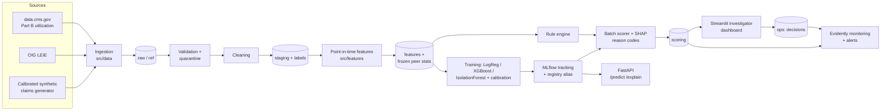

# System design: healthcare claims payment-integrity and FWA detection platform

Author: Faridoon Farahi. Status: locked (v1, Aug 2026). Companion: [roadmap.md](roadmap.md)

The platform scores healthcare claims for fraud, waste, and abuse (FWA) risk and answers five
operational questions:

| # | Question | Answered by |
|---|----------|-------------|
| 1 | Which claims should an investigator review? | Ranked review queue (ensemble risk score under capacity constraints) |
| 2 | Why was each claim flagged? | Reason codes: rule hits + SHAP feature contributions |
| 3 | What is the estimated financial risk? | `estimated_payment_at_risk = paid_amount × calibrated P(improper)` |
| 4 | How should claims be prioritized under limited investigator capacity? | Cost-based threshold/capacity optimizer (expected-net-value curve) |
| 5 | Is the deployed model drifting? | Evidently drift reports + alert thresholds + delayed-label performance |

Every output is a *review priority*, never a fraud determination. Fraud is a legal finding; this
system routes human attention.

## 1. Locked decisions

| Decision | Choice | Rationale |
|---|---|---|
| Claim-level data | Synthetic, calibrated to real CMS distributions | Claim-level Medicare data (RIFs) is access-restricted; public CMS data is aggregated. Duplicate and timing scenarios need synthesis, which is documented in §2. |
| Real data anchors | CMS Part B provider-service utilization + OIG LEIE + POS/NCCI-style references | Real peer benchmarks, real payment distributions, real code mix per specialty. |
| Gradient boosting | XGBoost | `scale_pos_weight` for imbalance, mature SHAP `TreeExplainer` support, widely used in fraud teams. LightGBM is a documented drop-in swap. |
| Review point | Post-payment integrity review | Paid amount is known at scoring time (no leakage); mirrors recovery/audit workflows. A pre-pay variant would drop paid-amount features. |
| Scale | ~350-400k claims, ~2k providers, 24 months | Pandas + Postgres handle this comfortably; PySpark is not needed at this scale. Scaling path documented in README. |
| Serving | Batch scoring to Postgres + real-time FastAPI on shared feature code | One feature implementation (`src/features`) is used offline and online, so there is no train/serve skew. |
| Model registry | MLflow registry, alias `production`; API falls back to a local bundle dir | API must boot without a tracking server (tests, demos, cold starts). |
| Deployment | Azure Container Apps + ACR + Azure Database for PostgreSQL | Matches the author's Azure background; scripts in `infra/azure/`. |
| DB migrations | SQLAlchemy metadata + SQL bootstrap (no Alembic) | Single-team portfolio scope; Alembic listed as future work. |

## 2. Data strategy

### 2.1 Real public sources (committed snapshots in `data/reference/`, full pulls via `src/data/`)

| Source | Used for | Access |
|---|---|---|
| CMS Medicare Physician & Other Practitioners, by Provider and Service | Peer-group benchmarks (specialty × HCPCS payment/volume distributions), provider profile calibration, real HCPCS descriptions | `data.cms.gov` data-api v1 (`src/data/ingest_cms.py`); a 480-row, 12-specialty calibration snapshot is committed with provenance metadata |
| OIG LEIE exclusion list | Real-world context for provider-level weak labels; loader provided | `oig.hhs.gov` CSV (`src/data/ingest_leie.py`); tests use a clearly-synthetic fixture |
| Reference code sets | POS codes (CMS standard), illustrative NCCI-style PTP unbundling pairs, E/M code levels, diagnosis groups | Authored CSVs in `data/reference/` with provenance notes in the data dictionary |

### 2.2 The label limitation

Adjudicated fraud/overpayment outcomes for claim-level data are **not public**. As a result:

1. Claim-level supervision labels here are **synthetic**: FWA patterns are injected into generated
   claims by documented rules (`docs/labeling.md`), with per-claim ground-truth pattern tags and
   injected improper amounts.
2. Generated labels live in a **separate schema** (`labels.*`) from claim facts (`staging.*`), and
   every field's provenance (real vs generated) is recorded in `docs/data_dictionary.md`.
3. Results measure *detection of documented synthetic patterns* and are never presented as real
   fraud discoveries. No real provider (NPI) is ever scored or displayed as risky; real NPIs exist only
   in aggregate benchmark tables.
4. The LEIE offers real *provider-level* weak labels (exclusions), but joining exclusions to
   utilization data yields sparse, survivorship-biased matches; it is included as context and a
   documented extension, not the primary target.

### 2.3 Synthetic claims generator (`src/data/synthetic/`)

Calibration: provider profiles are sampled from the real CMS snapshot (specialty mix, HCPCS
repertoire per specialty, per-code submitted/allowed/paid levels, facility/office split, volume
distributions). Simulation: ~2k synthetic providers (`PRV-…`), ~40k synthetic beneficiaries
(`BEN-…`), 24 months of claims with weekday seasonality, provider growth trends, panel structure,
code-dependent units, lognormal amount noise, modifiers (25/59/LT/RT), and benign confounders
(corrected-claim resubmissions, legitimately expensive claims) so the model faces real
false-positive pressure.

Injected FWA patterns (each with config-controlled prevalence, full parameters in `docs/labeling.md`):

| ID | Pattern | ID | Pattern |
|---|---|---|---|
| F01 | Exact duplicate resubmission (new claim ID) | F07 | Unbundling of PTP pairs (same day, no modifier 59) |
| F02 | Near-duplicate (tweaked modifier/dx/amount) | F08 | Sudden volume spike (phantom-style surge) |
| F03 | Rapid repeat of the same procedure | F09 | Diagnosis/procedure mismatch |
| F04 | Excessive units | F10 | Atypical place-of-service |
| F05 | Amount inflation vs code norms | F11 | Collusive patient-sharing cluster |
| F06 | E/M upcoding (level-skew) | F12 | Extreme single-code billing concentration |

Data-quality defects (missing POS, string-typed amounts, impossible dates, ingestion-duplicated
rows with the *same* claim ID) are injected separately so validation and cleaning have real work.
Cleaning must keep F01 fraud duplicates (different claim IDs, same content) while removing
same-ID ingestion artifacts, and a test checks this.

## 3. Architecture



Postgres schemas: `raw` (as-ingested), `ref` (code sets, benchmarks), `staging` (clean claims,
providers, beneficiaries), `labels` (generated supervision, quarantined from features), `features`
(point-in-time matrices + frozen peer stats), `scoring` (predictions, explanations, reason codes),
`ops` (investigator decisions, monitoring runs), `meta` (dataset/model versions).

## 4. Leakage prevention (design rules)

1. Temporal split: train / calibration-val / test by service month, with no random row splits
   (duplicates and provider behavior would straddle folds). First 3 months are burn-in (features
   only, never training rows).
2. As-of features: every rolling provider/beneficiary aggregate uses *strictly prior* claims
   (`closed='left'` windows keyed by service date).
3. Frozen peer stats: specialty×code norms are fit on the train window only, persisted as
   artifacts, and served unchanged to val/test/API.
4. Duplicates look backwards: a claim can only be flagged as a duplicate *of an earlier
   claim*, never of a future one.
5. Label isolation: `labels.*` columns can never enter the feature matrix (enforced by an
   automated test and a column-name contract).
6. Encoders/imputers fit on train only, inside persisted sklearn pipelines.

`tests/unit/test_leakage.py` asserts rules 2 to 5 mechanically (append-future-rows invariance, peer-stat
freezing, backward-only duplicates, label-column exclusion).

## 5. Modeling

| Model | Role | Notes |
|---|---|---|
| Rule engine (R001-R013) | Transparent baseline + reason codes + model features | Thresholds in `configs/rules.yaml`; mirrors payer SIU edit logic |
| Logistic regression | Calibrated linear baseline | class-weight balanced, one-hot + scaling pipeline |
| XGBoost | Primary risk scorer | `scale_pos_weight`, early stopping on PR-AUC, isotonic calibration on val |
| Isolation Forest | Unsupervised coverage of *unknown* schemes | Claim-level + provider-level variants; percentile-ranked anomaly score |
| Ensemble | Final risk | `w·P_calibrated + (1−w)·anomaly_percentile`, `w` tuned on val by net-value@capacity |

Class imbalance (~4-5% positives) is handled with class weights / `scale_pos_weight` plus
threshold optimization. Resampling was evaluated once and would be adopted only if it beat
weighting on both PR-AUC and calibration. Accuracy is never a headline metric. A *novel-scheme
holdout* experiment retrains without F09/F11 labels and measures whether the anomaly path still
surfaces them, which shows what the unsupervised leg adds.

## 6. Evaluation and financial thresholding

Reported: precision / recall / F1 (at operating point), PR-AUC (primary), ROC-AUC (secondary),
confusion matrix, recall@top-1/5/10% of claims, precision@investigator-capacity, calibration
(reliability curve, Brier), and lift. Financial metrics: dollars flagged, dollars identified per
1,000 reviewed claims, false-positive review cost, and

```
Expected net value = expected recoverable payment − investigation cost − false-positive operational cost
ENV(policy) = recovery_rate · Σ_TP improper_paid  −  review_cost · N_reviewed  −  fp_cost · N_FP
```

The optimizer sweeps thresholds and capacity constraints to produce an ENV curve and a recommended
operating point. Users can adjust investigator capacity, review cost, recovery rate, FP cost, and
minimum risk threshold (`configs/costs.yaml` and the dashboard simulator). A CI
model-quality gate retrains on a fixture and fails the pipeline if PR-AUC or recall@5% drop below
floors.

## 7. Explainability

Each prediction returns a risk score, recommended action (`auto_clear` / `queue` / `manual_review`),
estimated payment at risk, top reason codes (rule hits ∪ SHAP-derived, mapped via
`configs/reason_codes.yaml`), signed SHAP contributions (OHE columns aggregated back to parent
features), model version, and timestamp. Global SHAP summaries feed the model card. Batch explanations
are precomputed to `scoring.explanations`; `/explain` computes on demand.

## 8. Serving

FastAPI (`app/api`): `GET /health`, `GET /model-info`, `POST /predict`, `POST /batch-predict`
(limit `BATCH_PREDICT_LIMIT`), `POST /explain`, `GET /metrics` (Prometheus text). Pydantic v2
validation with domain ranges (HCPCS format, POS enum, non-negative amounts, sane dates), clear
422 errors, request-ID middleware, structured JSON logs, model version on every response. Online feature
assembly joins request payloads with the frozen peer stats and latest provider aggregates loaded at
startup; unknown providers get cold-start defaults plus an `insufficient_provider_history` flag.

Streamlit (`app/dashboard`): portfolio KPIs, review queue (capacity-aware), claim detail (SHAP
waterfall, reason codes, similar claims, provider peer comparison), provider risk ranking,
threshold simulator, monitoring status, and investigator decision capture (approved / dismissed /
pending, stored in `ops.review_decisions`, which later feeds delayed-performance monitoring). Synthetic IDs
only; no PHI exists anywhere in the system.

## 9. MLOps

MLflow logs params, feature list + hash, dataset version, split config, metrics, calibration
artifacts, threshold policy, SHAP background, environment, git commit, and the model signature;
the selected run is registered as `claims-risk` with alias `production`. Evidently monitors
input feature drift, missing-value shifts, prediction/score drift (PSI), provider/procedure mix
divergence, and data-quality failures against a frozen reference window; thresholds in
`configs/monitoring.yaml` drive WARN/CRITICAL statuses written to `ops.monitoring_runs` and
shown in the dashboard. A drift-simulation flag demonstrates alerts end to end. Once
investigator decisions accumulate, a delayed-label report tracks the realized precision of flags.

CI/CD (GitHub Actions) runs, in order: ruff format, ruff lint, mypy, unit tests, integration tests
(Postgres service), the model-quality gate, Docker build, and a containerized API health smoke
test. On `main`, with secrets, it then builds and pushes to ACR and updates Azure Container Apps. Deployment topology:
ACR + two Container Apps (API, dashboard) + Azure Database for PostgreSQL Flexible Server;
scripts in `infra/azure/`, guide in `docs/deployment.md`.

## 10. Repository layout

```
healthcare-payment-integrity/
├── app/                  # serving layer
│   ├── api/              #   FastAPI (routers, middleware, main)
│   ├── dashboard/        #   Streamlit multipage app
│   ├── schemas/          #   Pydantic request/response models
│   └── services/         #   model bundle loading, online feature assembly, scoring
├── configs/              # YAML: generation, validation, features, rules, model, costs, reasons, monitoring
├── data/
│   ├── raw/  interim/  processed/   # gitignored, reproducible
│   └── reference/        # committed real-data snapshots + code sets (with provenance)
├── docs/                 # this file, roadmap, data dictionary, labeling, model card, guides
├── infra/azure/          # Azure Container Apps deploy scripts
├── models/               # local model bundles (claims-risk-vX/)
├── monitoring/reports/   # Evidently HTML/JSON outputs
├── notebooks/            # EDA + analysis (thin; logic lives in src/)
├── scripts/              # CLI entrypoints + SQL bootstrap
├── src/                  # data / features / modeling / evaluation / utils
├── tests/                # unit + integration (+ fixtures)
└── .github/workflows/    # CI/CD
```

## 11. Responsible use and privacy

All beneficiaries, providers, and claims that receive risk scores are synthetic; real CMS rows are
provider-level public aggregates used only as benchmarks. No protected attributes are used as
features; specialty/geography enter only through peer normalization, and disparate-impact
considerations are discussed in `docs/ethics_limitations.md`. The system is designed for
human-in-the-loop review with decision capture, never automated denial or accusation.
