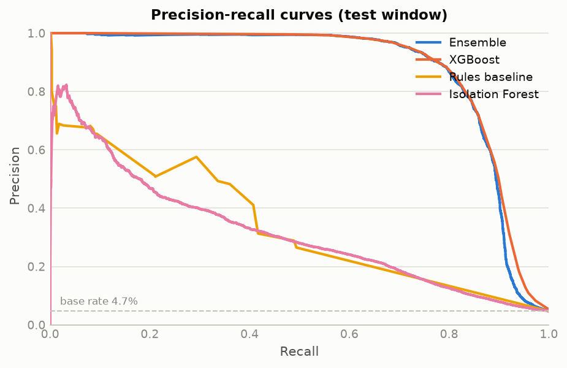
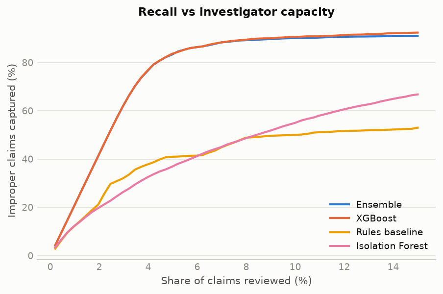
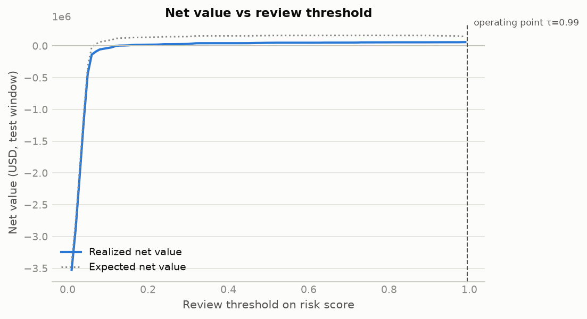
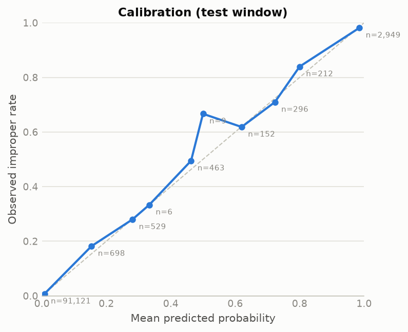
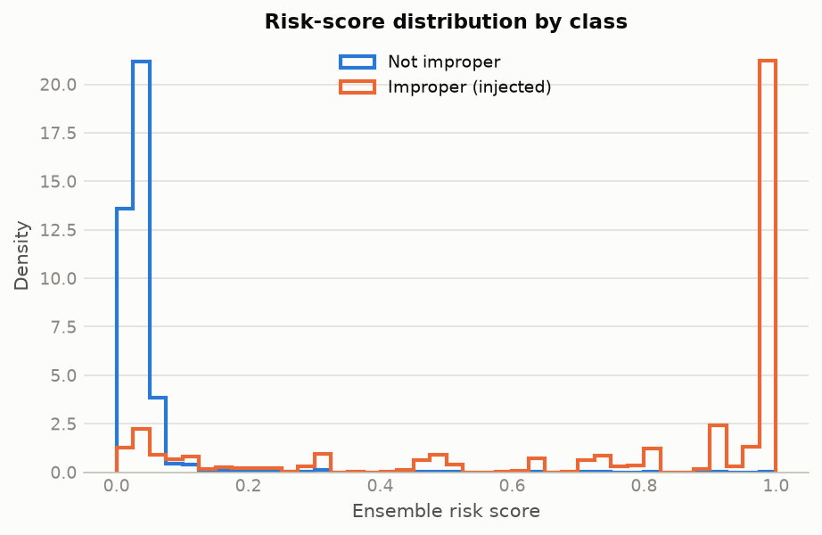
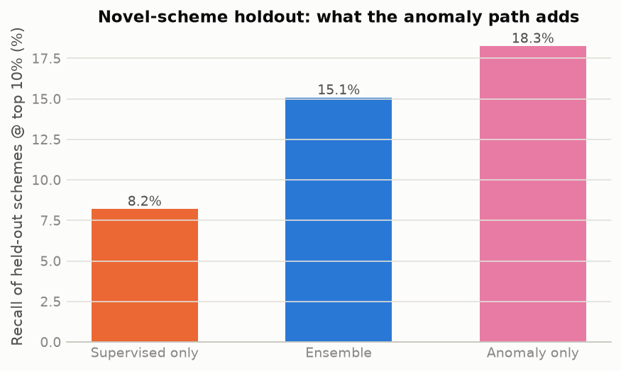

# Evaluation report: claims-risk claims-risk-v1.0.0

Generated 2026-08-07 06:36 UTC · dataset `ds-7996bf5a94f9` · test window 2025-07 to 2026-01 (96,435 claims, 4.72% labeled improper).

> Labels are **synthetic injected patterns** (see `labeling.md`). Every number below
> measures detection of documented injections, not real-world fraud performance.

## Model comparison (test window)

| Model               |   PR-AUC |   ROC-AUC |   Recall@1% |   Recall@5% |   Recall@10% |
|:--------------------|---------:|----------:|------------:|------------:|-------------:|
| rules baseline      |   0.2734 |    0.7215 |       0.123 |       0.409 |        0.5   |
| logistic regression |   0.5708 |    0.9098 |       0.17  |       0.607 |        0.755 |
| xgboost             |   0.8807 |    0.9629 |       0.212 |       0.836 |        0.907 |
| isolation forest    |   0.3155 |    0.8367 |       0.125 |       0.372 |        0.55  |
| ensemble            |   0.8714 |    0.9481 |       0.211 |       0.835 |        0.901 |

## Operating point

Review threshold **τ = 0.9945** (max of ENV-optimal τ 0.73, capacity-implied τ 0.9945 at 1.0% capacity, and the 0.2 risk floor).

Confusion matrix at τ: TP 1,055, FP 6, FN 3,495, TN 91,879. Precision 0.994, recall 0.232, F1 0.376.

## Financial value under capacity scenarios (test window, realized)

| capacity_share   |   n_reviewed |   precision |   recall | dollars_recovered   | net_value   | dollars_identified_per_1000_reviewed   | expected_net_value   |
|:-----------------|-------------:|------------:|---------:|:--------------------|:------------|:---------------------------------------|:---------------------|
| 0.5%             |          482 |       0.994 |    0.105 | $56,179             | $41,683     | $187,989                               | $81,635              |
| 1.0%             |          964 |       0.994 |    0.211 | $78,253             | $49,261     | $130,927                               | $106,139             |
| 2.0%             |         1928 |       0.994 |    0.421 | $118,053            | $60,069     | $98,759                                | $144,154             |
| 5.0%             |         4821 |       0.788 |    0.835 | $176,824            | $19,906     | $59,158                                | $137,601             |
| 10.0%            |         4860 |       0.784 |    0.837 | $177,286            | $18,874     | $58,836                                | $136,483             |

Cost assumptions: review $30.0/claim, recovery rate 62%, false-positive overhead $12.0/claim (configs/costs.yaml; these are scenario parameters, not validated actuals).

## Calibration

Brier 0.0119, ECE 0.0013 (isotonic-calibrated supervised probability).

## Novel-scheme holdout

Retrained with F09 (dx mismatch) and F11 (collusion) removed from training labels, then measured on exactly those claims in test:

| Review capacity   | Supervised only   | Ensemble   | Anomaly only   |
|:------------------|:------------------|:-----------|:---------------|
| top 1%            | 0.0%              | 0.0%       | 0.5%           |
| top 5%            | 1.8%              | 1.8%       | 9.4%           |
| top 10%           | 8.2%              | 15.1%      | 18.3%          |

The unsupervised path recovers part of the schemes the supervised model has never seen, but it still misses most of them. No single detector is enough, so layered controls and continuing rule development are still needed.

## Per-pattern detection (ensemble, test window)

| Pattern                |   Test claims |   Flagged at τ | Recall   |
|:-----------------------|--------------:|---------------:|:---------|
| F04_excessive_units    |           301 |            235 | 78.1%    |
| F02_near_duplicate     |           511 |            164 | 32.1%    |
| F09_dx_mismatch        |           180 |              6 | 3.3%     |
| F11_collusion_cluster  |           464 |             15 | 3.2%     |
| F05_amount_inflation   |           997 |            292 | 29.3%    |
| F12_code_concentration |           649 |            163 | 25.1%    |
| F10_pos_anomaly        |           228 |             50 | 21.9%    |
| F07_unbundling         |           273 |             51 | 18.7%    |
| F03_rapid_repeat       |           206 |             37 | 18.0%    |
| F01_exact_duplicate    |           507 |             88 | 17.4%    |
| F06_upcoding           |            71 |              1 | 1.4%     |
| F08_volume_spike       |           239 |              0 | 0.0%     |