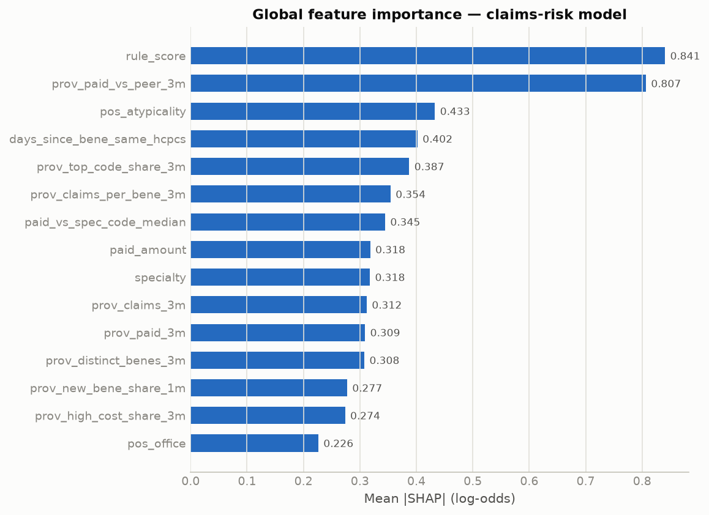

# Model Card — `claims-risk-v1.0.0`

## Overview

| | |
|---|---|
| Model | Ensemble: isotonic-calibrated XGBoost (w=0.95) + IsolationForest anomaly percentile (w=0.05) |
| Task | Rank healthcare claims by probability of improper payment for human review |
| Registry | MLflow `claims-risk` @ `production` · local bundle `models/claims-risk-v1.0.0/` |
| Inputs | 45 numeric + 3 categorical features (claim, beneficiary-history, provider-behavior, rule signals) |
| Output | `risk_score ∈ [0,1]`, calibrated `supervised_probability`, anomaly percentile, reason codes |
| Decision policy | τ = 0.9945 (max of ENV-optimal 0.73, 1%-capacity cutoff, 0.20 risk floor); actions: manual_review / monitor / auto_clear |
| Trained | Aug 2026 · dataset `ds-7996bf5a94f9` · 187,571 train rows (12 months) · scale_pos_weight ≈ 21 |

## Intended use & users

Post-payment claim review prioritization for payment-integrity teams; investigator dashboard and
scoring API. **Not** for automated denial, provider sanctioning, or any adjudication without human
review. Scores are review priorities; "improper" here means *matched a documented synthetic
pattern*, not adjudicated fraud.

## Training data

Synthetic claim-level data calibrated to real CMS Medicare Part B provider-service distributions
(12 specialties; committed snapshot with provenance). 12 injected FWA pattern families (~4.5% of
claims) + benign confounders. Labels are generated and kept in a separate schema; complete
assumptions in [labeling.md](labeling.md). **No real beneficiary data exists anywhere in the
system; no real provider is scored.**

## Performance (temporal test window, 96,435 claims)

PR-AUC **0.881** (XGBoost) / 0.871 (ensemble) vs 0.047 base rate; ROC-AUC 0.963; recall@5% review
capacity 0.836; precision 0.994 at the production threshold; Brier 0.0119, ECE 0.0013. Financials
under the default cost scenario: net value $49.3k at 1% capacity on the window. Per-pattern recall
varies widely — F04 unit inflation 78% down to F08 volume spikes 0% at τ (spikes are a
provider-level, lagged signal — surfaced by the provider view rather than claim-level τ). Details +
charts: [evaluation_report.md](evaluation_report.md).

## Explainability

Per-claim SHAP (TreeExplainer) contributions folded to raw features; reason codes merge
deterministic rule hits with SHAP drivers; global importance (top: `rule_score`,
`prov_paid_vs_peer_3m`, `pos_atypicality`, `days_since_bene_same_hcpcs`,
`prov_top_code_share_3m`):

## Ethical considerations

No protected attributes as features; specialty/geography enter only via peer normalization.
Human-in-the-loop by design with decision capture and delayed-precision monitoring. Full
discussion incl. disparate-impact considerations and abrasion costs:
[ethics_limitations.md](ethics_limitations.md).

## Caveats & limitations

- **Synthetic-label ceiling:** separability is optimistic vs real adjudicated outcomes; treat
  metrics as pipeline-quality evidence, not production forecasts.
- Novel schemes outside the injected families are mostly missed (novel-scheme holdout: anomaly
  path recovers 9–18% at 5–10% capacity); layered rules + monitoring remain necessary.
- Cold-start providers (<2 months history) score with degraded features and are flagged via
  `insufficient_provider_history`.
- Calibration is with respect to synthetic prevalence (~4.5%); real prevalence differs.
- Single-line professional claims; no institutional claim structures.

## Maintenance

Retrain: `make pipeline` (new dataset version + registry version + alias flip). Monitor:
`make monitor` (drift thresholds in `configs/monitoring.yaml`; runbook in
[monitoring.md](monitoring.md)). Quality regression gate runs in CI on every push.
